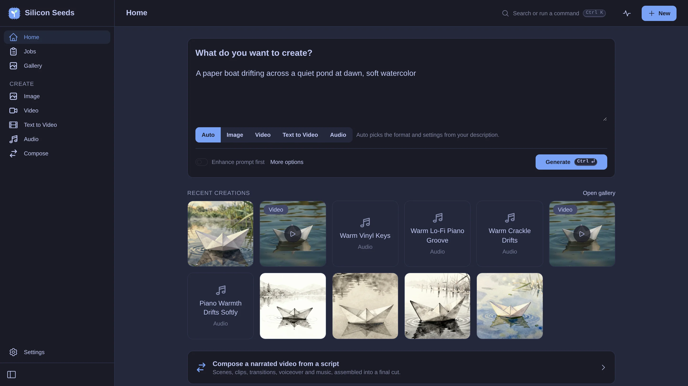
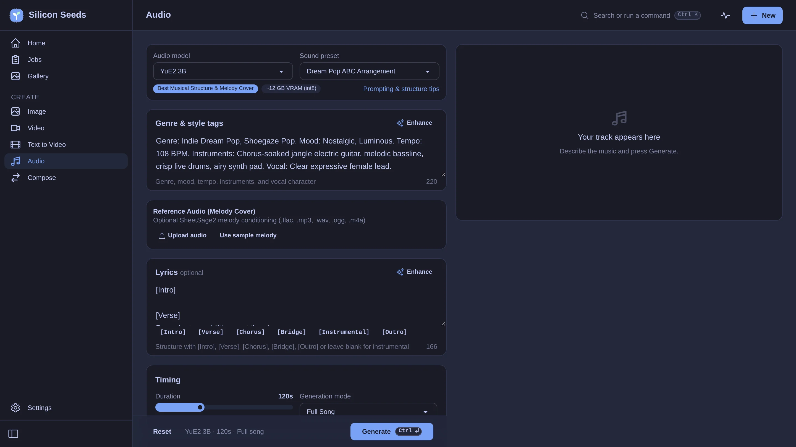
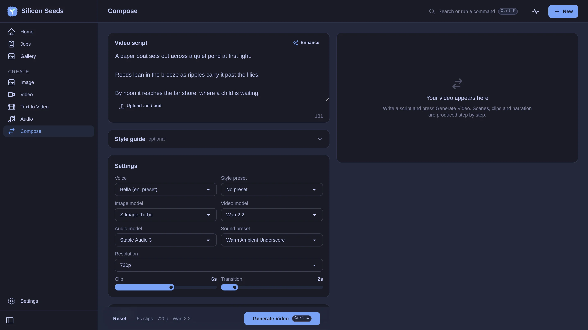
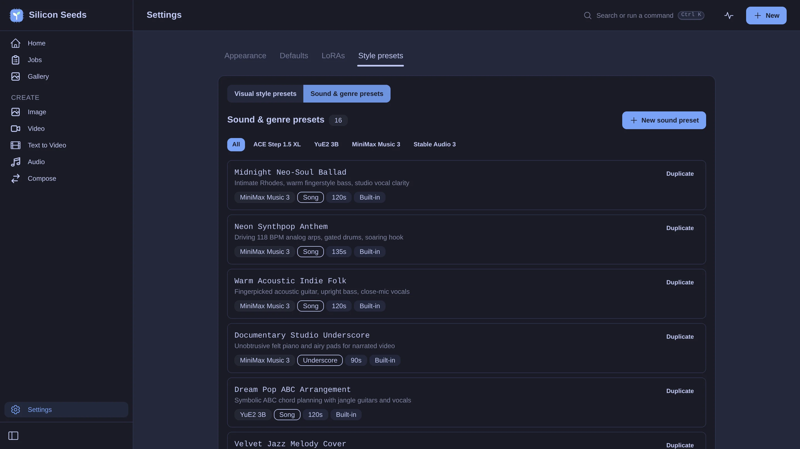
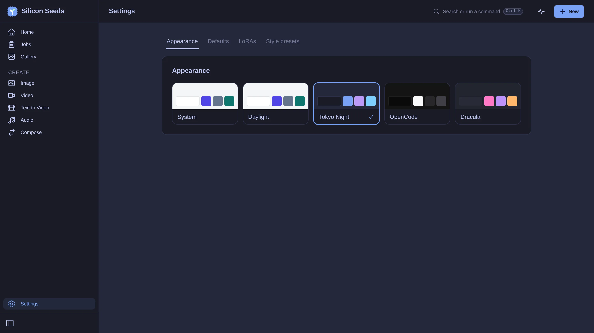
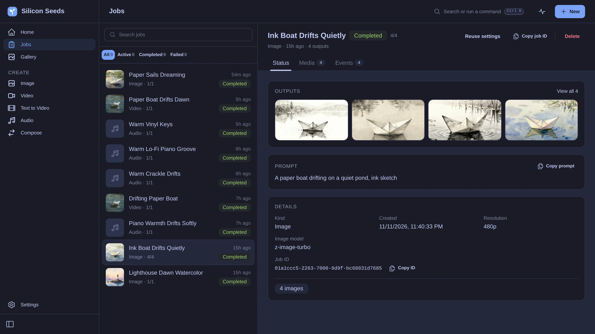
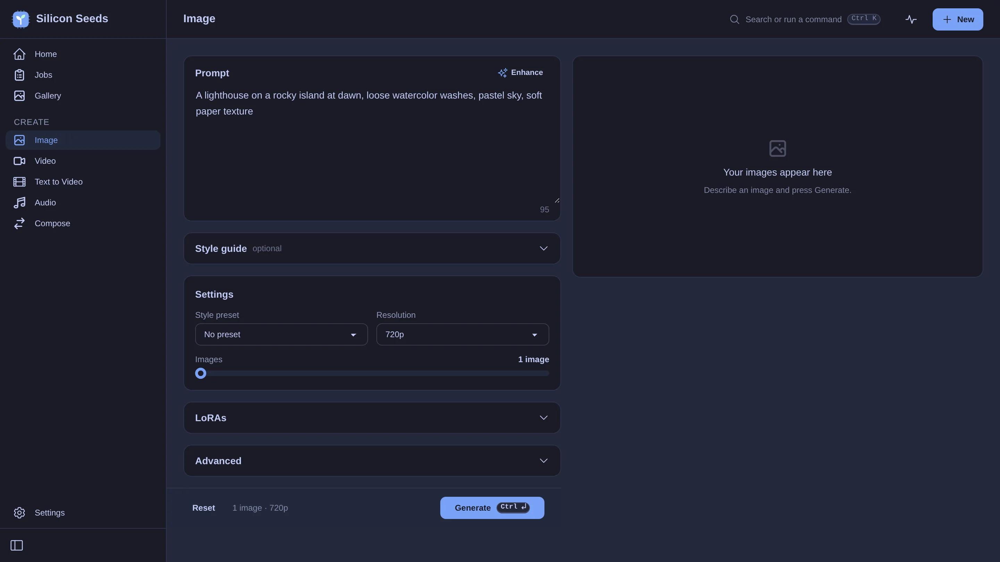
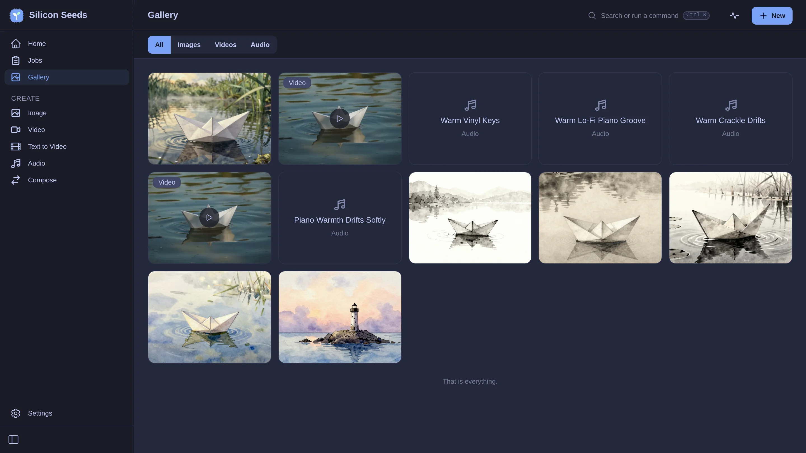
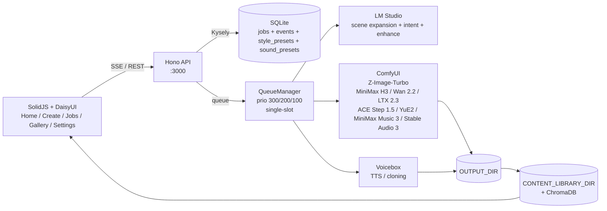

<p align="center">
  
</p>

<h1 align="center">Silicon Seeds</h1>

<p align="center">
  <em>Whoever has ears, let them hear.</em><br/>
  Local generative media studio - script to screen, fully offline, fully yours.
</p>

<p align="center">
  <a href="LICENSE"></a>
  =1.3" />
  
  
  
  
  
  
  
</p>

<p align="center">
  <a href="#showcase">Showcase</a> •
  <a href="#quick-start">Quick Start</a> •
  <a href="#features">Features</a> •
  <a href="#architecture">Architecture</a> •
  <a href="#service-dependencies">Services</a> •
  <a href="#testing">Testing</a> •
  <a href="#troubleshooting">Troubleshooting</a>
</p>

---

> **License:** GPL-3.0-or-later - see [LICENSE](LICENSE). Any derivative or service that includes this code must remain open under the same license.

Local generative media studio. Orchestrates **LM Studio** (text), **ComfyUI** (image / multi-model video / multi-model audio), **SQLite + Kysely** (jobs & presets), and a **SolidJS + DaisyUI** frontend to turn prompts, scripts, reference images, and reference audio into images, videos (including video clips with native stereo audio), songs, melody covers, sound effects, and composed films. Queue is DB-backed, UI is SSE-driven, everything runs on your hardware.

---

## Showcase

<table>
<tr>
<td colspan="2" align="center">

**Home - describe it, Auto plans it**

One prompt box. Auto mode picks the format and settings from your description; running jobs and recent creations sit right below.



</td>
</tr>
<tr>
<td width="50%">

**Audio Studio - 4 models, sound presets, melody cover**

Switch between ACE Step 1.5 XL, YuE2 3B (ABC Score planning + SheetSage2 Melody Cover from Reference Audio), MiniMax Music 3 (3-part studio captions), and Stable Audio 3 (instrumentals, loops, SFX + Qwen Reprompting).



</td>
<td width="50%">

**Compose - script to film with selectable underscore**

Script + style guide + voice + LoRAs + configurable Audio Model & Sound Preset -> speech -> scenes -> images -> videos -> transitions -> instrumental underscore -> concat.



</td>
</tr>
<tr>
<td width="50%">

**Sound & Style Presets - curated built-ins and custom CRUD**

16 built-in sound & genre presets across all 4 audio models (duplicable into custom presets) alongside visual style presets in `/settings?tab=presets`.



</td>
<td width="50%">

**Settings - appearance, defaults, LoRAs, presets**

Tabs for Appearance (themes), Defaults (prefill new jobs including default studio and compose audio models), LoRAs (synced from ComfyUI, reorder, toggle active), and Style & Sound presets.



</td>
</tr>
<tr>
<td width="50%">

**Jobs - master-detail and live timeline**

Job list and detail view at `/jobs/<id>` with status filters, search, Status / Media / Events tabs, media lightbox, and job/event actions.



</td>
<td width="50%">

**Create Studio - shared layout and AI prompt enhance**

Shared studio layout across Image, Video, Text-to-Video, Audio, and Compose with AI prompt Enhance (and Undo chain), style presets, LoRA stacking, local drafts, and live result panels.



</td>
</tr>
<tr>
<td colspan="2" align="center">

**Gallery - filters and lightbox**

Persistent gallery backed by `CONTENT_LIBRARY_DIR` with type filters, cursor pagination, and a lightbox viewer.



</td>
</tr>
</table>

---

## Quick Start

### Installation

```bash
git clone https://github.com/DennisLoska/silicon-seeds.git
cd silicon-seeds
bun install
cp .env.example .env   # edit paths above
bun run db:migrate      # creates data/silicon-seeds.sqlite + style_presets, sound_presets, loras tables
```

Validate setup:

```bash
bunx tsc --noEmit
curl http://127.0.0.1:8188/system_stats  # ComfyUI
curl http://127.0.0.1:1234/v1/models     # LM Studio API
curl http://127.0.0.1:17493/profiles     # Voicebox (if used)
```

### Running

```bash
# backend + frontend (hot reload)
bun run start:hot
# or without hot reload
bun run start
```

- Frontend (Vite dev, proxied): `http://127.0.0.1:5174` -> API at `3000`
- Backend (Hono): `http://127.0.0.1:3000`
- Health: `curl http://localhost:3000/api/health` -> `{"status":"up"}`

Production build (serves SPA from `dist/client`):

```bash
bun run build           # -> dist/client (vite, outDir ../../dist/client from src/client)
bun run start           # serves http://localhost:3000
```

Useful commands:

```bash
bun run test           # tsc (server + client) + eslint (no services needed)
bun run test:unit      # bun test src scripts (no services needed)
bun run lint
bun run format:check   # prettier --check .
bun run db:rollback    # last migration
bun run db:chroma      # start local Chroma (path from CONTENT_LIBRARY_DIR, port from CHROMADB_PORT)
bun run setup:minimax-h3            # provision MiniMax H3 weights, LoRAs, style embeddings, sample images & templates into COMFYUI_DIR (or parent of INPUT_DIR)
bun run setup:minimax-h3 --dry-run  # dry-run verification of MiniMax H3 ComfyUI assets (no downloads or writes)
```

---

## Testing

```bash
bun run test       # typecheck (server + client tsc) + lint (eslint .) - no services needed
bun run test:unit  # bun test src scripts (unit + convention/guard tests) - no services needed
bun run test:e2e   # Playwright specs in e2e/ (shell, kit, home, jobs, settings, gallery, create-image/video/audio, text-to-video, compose, live-updates)
```

Every e2e spec imports `test` from `e2e/helpers/test.ts`, which blocks every request that could start GPU or LLM work; live generation is never part of the automated suite.
Playwright runs against `http://localhost:3000` (override via `PLAYWRIGHT_BASE_URL`) and builds the client before starting the server when needed.
Variants: `bun run test:e2e:headed`, `bun run test:e2e:ui`.

---

## Features

| Area | What you get |
|------|--------------|
| **Home & Auto mode** | Quick create bar with Auto, Image, Video, Text-to-Video, and Audio modes, active job cards, and recent creations. In Auto mode (`POST /api/intent`), the planner picks the format and rewrites the prompt while deterministic rules decide kind, counts, sizes, and durations. |
| **Multi-Model Video Studio** | Three ComfyUI video backbones in `/create/video`, `/create/text-to-video`, and `/compose`: **MiniMax H3** (open-weights omni-modal video with native joint stereo audio generation; 4 modes: `t2v`, `i2v`, `fl2v` First + Last Frame, and `multiframe` `<Picture 1..9>` with `MiniMaxH3AddGuide` timeline keyframe guides; 4 speed/quality variants: 8-Step Turbo LoRA, 4-Step Turbo LoRA, FastH3 8-Step VSA, and 20-Step Standard; 10 style embeddings `embedding:minimaxh3_<id>`; joint stereo `soundscape` and `music` conditioning; native `768p`, `1:1 (768)`, and `4:3 (768)` resolutions), **Wan 2.2 14B**, and **LTX 2.3**, plus multi-clip **Video Sequencing** (`continuation` last-frame chaining and `transition` AI transitions with stereo audio concatenation). |
| **Multi-Model Audio Studio** | Four ComfyUI audio backbones in `/create/audio` with dynamic model controls and graph-pruning workflow builders: **ACE Step 1.5 XL** (fast vocal/instrumental tracks with BPM, Key/Scale, Time Signature), **YuE2 3B** (symbolic ABC Score chord planning + **SheetSage2 Melody Cover** from uploaded Reference Audio or built-in sample), **MiniMax Music 3** (studio vocal flagship with 3-part `Global Metadata` / `Vocal Details` / `Arrangement` scaffold, `int8`/`fp16`, tiled VAE decode), and **Stable Audio 3** (8-step `medium` & 50-step `medium_base` instrumentals, loops, SFX, one-shots up to 180s with optional Qwen3.5-2B **Reprompting**). |
| **Sound & Style Presets** | 16 curated built-in **Sound Presets** tailored to each audio model's prompt and lyric format, plus custom Sound Preset CRUD (`/api/sound-presets`) alongside **Style Presets** (`/api/style-presets`) in `/settings?tab=presets`. |
| **Compose & Underscore** | End-to-end narrated film pipeline (`/compose`): script or `.txt`/`.md` + style guide + Voicebox TTS + Z-Image-Turbo + MiniMax H3 / Wan 2.2 / LTX 2.3 + configurable **Underscore** audio model and sound preset. |
| **Create Studio & AI Enhance** | Shared `StudioLayout` across Image (`/create/image`), Video (`/create/video`), Text-to-Video (`/create/text-to-video`), Audio (`/create/audio`), and Compose (`/compose`) with local per-route drafts, preset-aware AI prompt Enhance (with Undo chain) and Inspire, LoRA stacking, and a live `ResultPanel`. |
| **Activity & Toasts** | Topbar Activity panel listing running, queued, and recent jobs with pause/resume/cancel actions, plus completion and failure toasts with direct links to `/jobs/<id>`. |
| **Command Palette** | `Ctrl K` (or `Cmd K`) opens a keyboard-navigable palette for routes, settings sections, recent jobs, themes, and quick create for typed prompts. |
| **Jobs** | Master-detail view (`/jobs` and `/jobs/:id?tab=status\|media\|events`) with status filter chips, search, step timeline, media grid with lightbox, "Reuse settings" prefill (preserving per-model audio defaults), per-event regenerate, and job pause, resume, retry, cancel, and delete actions. |
| **Gallery** | Content library backed by `CONTENT_LIBRARY_DIR` with type filters (`all`, `image`, `video`, `audio`), cursor pagination, server-rendered thumbnails (`/thumbs/*`), and a lightbox with job links. |
| **Settings** | Tabbed interface (`/settings?tab=appearance\|defaults\|loras\|presets`) covering Appearance (System, Daylight, Tokyo Night, OpenCode, and Dracula themes), Defaults (resolution, image/video/audio/compose models, FPS, durations, presets), LoRAs (sync from ComfyUI, toggle active, reorder, delete), and Visual Style + Sound & Genre presets. |
| **Shell & Favicon** | Collapsible sidebar, responsive mobile drawer, `New` create menu, and SVG favicon (`src/client/favicon.svg`). |
| **Local-first** | No cloud or external API keys. Bring your own ComfyUI and LM Studio; optional Voicebox and ChromaDB degrade gracefully. |

---

## Architecture



**Request flow:** `Create -> POST /api/jobs/*` -> DB `jobs` + `events` rows -> `QueueManager.pump()` picks next event by priority -> driver (LLM / ComfyUI / TTS) executes -> writes artifact to `OUTPUT_DIR` -> copies to `CONTENT_LIBRARY_DIR` -> SSE pushes update -> UI re-renders. ComfyUI progress arrives via WebSocket (`COMFYUI_BASE_WS`).

**Multi-model video & MiniMax H3 workflow builder:** `src/shared/video-models.ts` defines the isomorphic registry for `minimax-h3`, `wan2.2`, and `ltx2.3` (modes, speed/quality variants, style embeddings, and resolutions). `src/comfyui/minimax-h3-workflows.ts` builds the ComfyUI graph per job for T2V, I2V, FL2V, and Multi-Frame `<Picture 1..9>` with `MiniMaxH3AddGuide` keyframe guides, prunes unused LoRA/VSA nodes, and wires the joint stereo audio VAEs. `src/video/reference-images.ts` validates reference frames and stages them into ComfyUI's `INPUT_DIR`. `VideoGenerator.advance_continuation` extracts the last frame of each clip to seed the next one, and `VideoGenerator.combine_outputs` concatenates multi-clip sequences with ffmpeg while preserving stereo audio.

**Multi-model audio & graph pruning:** `src/shared/audio-models.ts` defines the isomorphic registry for `ace-step-1.5`, `yue2`, `minimax-music-3`, and `stable-audio-3` (capabilities, duration bounds, lyric formatting, and default settings). `src/comfyui/audio-workflows.ts` constructs fresh, pruned ComfyUI API graphs per job so inactive auxiliary subgraphs (such as `SheetSage2AudioToABC`, `YuE2GenerateABC`, or `Qwen3.5-2B` reprompting) are omitted rather than loaded into VRAM. Uploaded Reference Audio for YuE2 Melody Covers is validated and staged into ComfyUI's `INPUT_DIR` via `src/audio/reference-audio.ts`.

**Client data layer:** A single SSE connection (`/jobs/stream/all`) with server heartbeats feeds the client job store (`src/client/stores/jobs.ts`). The store holds the job list, tracks per-job signatures and stream epochs, runs a staleness watchdog with exponential-backoff reconnect and a 10-second polling fallback while jobs are active, and drives the Activity panel and completion/failure toasts. Per-job views (`JobDetail`, `ResultPanel`) subscribe to the store via `onJobUpdate` and refetch only when their job's signature or the stream epoch changes.

**UI kit and `/dev/kit`:** Shared components in `src/client/components/ui/` (`Field`, `SliderField`, `SelectField`, `Segmented`, `TabLink`, `StatusBadge`, `EmptyState`, `Modal`, `ConfirmHost`, `Toaster`, `MediaTile`, `Lightbox`, `CopyButton`) implement the flat bordered `panel` aesthetic and top-layer dialog/toast coordination. The `/dev/kit` route renders every UI kit component interactively for development and e2e verification.

---

## Prerequisites

- **Bun** >=1.3 (`curl -fsSL https://bun.sh/install | bash`)
- [**ComfyUI**](https://github.com/comfyanonymous/ComfyUI) running locally (default `http://127.0.0.1:8188`)
- [**LM Studio**](https://lmstudio.ai/) with API server enabled (default `http://127.0.0.1:1234`) and models loaded
- **ffmpeg + ffprobe** (`sudo pacman -S ffmpeg` / `brew install ffmpeg`)
- [**Voicebox**](https://github.com/JarodMica/voicebox) (optional, for TTS in Compose) - default `http://127.0.0.1:17493`
- **ChromaDB** (optional, for gallery search) - default `http://127.0.0.1:8000`

---

## Service dependencies

| Service | Default URL | Required | What it does |
|---------|-------------|----------|--------------|
| [ComfyUI](https://github.com/comfyanonymous/ComfyUI) | `http://127.0.0.1:8188` | yes | Image (Z-Image-Turbo), video (MiniMax H3 + stereo audio / Wan 2.2 / LTX 2.3), audio (ACE Step 1.5 XL, YuE2 3B + SheetSage2, MiniMax Music 3, Stable Audio 3) |
| [LM Studio](https://lmstudio.ai/) | `http://127.0.0.1:1234` | yes | LLM text, scene prompts, style expansion, prompt enhancement, intent planning, job naming |
| [Voicebox](https://github.com/JarodMica/voicebox) | `http://127.0.0.1:17493` | for Compose | TTS for script -> speech |
| ChromaDB | `http://127.0.0.1:8000` | no | Vector search for gallery |

If Voicebox / Chroma are not running, the app still starts - related features just fail at runtime with a clear error.

---

## Environment variables

Copy `.env.example` to `.env` and edit paths. All vars are read via `Bun.env`.

| Variable | Required | Default | Description |
|----------|----------|---------|-------------|
| `COMFYUI_BASE_URL` | yes | `http://127.0.0.1:8188` | ComfyUI HTTP API |
| `COMFYUI_BASE_WS` | yes | `ws://127.0.0.1:8188` | ComfyUI WebSocket for queue events |
| `OUTPUT_DIR` | yes | - | ComfyUI `output` dir (where Comfy writes images/videos) |
| `INPUT_DIR` | yes | - | ComfyUI `input` dir (where app stages uploads) |
| `COMFYUI_DIR` | no | parent of `INPUT_DIR` | ComfyUI root directory for `setup:minimax-h3` weight/template installation and asset status checks |
| `HF_TOKEN` | no | - | Optional Hugging Face token used by `setup:minimax-h3` when downloading weights from `huggingface.co` |
| `CONTENT_LIBRARY_DIR` | yes | - | Persistent gallery dir (e.g. `~/content_library`) |
| `SCRIPTS_DIR` | no | `<CONTENT_LIBRARY_DIR>/scripts` | Where text-to-script saves generated `.md` files |
| `HOST` | no | `127.0.0.1` | Server bind host (set `0.0.0.0` only on trusted networks, app has no auth) |
| `PORT` | no | `3000` | Server bind port |
| `DB_PATH` | no | `data/silicon-seeds.sqlite` | SQLite file override |
| `LLM_MODEL` | yes | - | LM Studio model id, e.g. `qwen3.6-35b-a3b` |
| `EMBEDDING_MODEL` | yes | - | LM Studio embedding model, e.g. `text-embedding-qwen3-embedding-8b` |
| `VOICEBOX_URL` | no | `http://127.0.0.1:17493` | Voicebox TTS server |
| `CHROMADB_HOST` | no | `127.0.0.1` | Chroma host |
| `CHROMADB_PORT` | no | `8000` | Chroma port |
| `LOG_LEVEL` | no | `info` | `debug`/`info`/`warn`/`error` |
| `NODE_ENV` | no | `development` | `development` / `production` |

Example `.env`:

```bash
COMFYUI_BASE_URL=http://127.0.0.1:8188
COMFYUI_BASE_WS=ws://127.0.0.1:8188
OUTPUT_DIR=/path/to/comfy-ui/output
INPUT_DIR=/path/to/comfy-ui/input
CONTENT_LIBRARY_DIR=/home/you/content_library
SCRIPTS_DIR=/home/you/content_library/scripts
HOST=127.0.0.1
PORT=3000
LLM_MODEL=qwen3.6-35b-a3b
EMBEDDING_MODEL=text-embedding-qwen3-embedding-8b
VOICEBOX_URL=http://127.0.0.1:17493
CHROMADB_HOST=127.0.0.1
CHROMADB_PORT=8000
LOG_LEVEL=info
```

---

## First run

1. Open `http://localhost:3000` -> `Home` (or press `Ctrl K` to open the command palette).
2. Go to `Settings` -> `Appearance` to pick a theme, `LoRAs` -> `Sync from ComfyUI` to import LoRAs, and `Defaults` / `Style presets` (Visual style presets & Sound & genre presets) to configure defaults.
3. **Quick create:** Type a prompt on `Home` in `Auto` mode (or pick `Image`, `Video`, `Text to Video`, `Audio`) and click `Generate`.
4. **Create pages & Compose:** Open `/create/image`, `/create/video` (select between MiniMax H3 with T2V, I2V, FL2V, Multi-Frame `<Picture 1..9>`, native stereo audio, and multi-clip sequences, Wan 2.2, or LTX 2.3), `/create/text-to-video`, `/create/audio` (select between ACE Step 1.5 XL, YuE2 3B with ABC Score & Melody Cover, MiniMax Music 3, or Stable Audio 3), or `/compose` for full controls, local drafts, and the inline result panel.
5. **Jobs & Gallery:** Track active work in the topbar Activity panel or `/jobs/<id>`, and browse outputs in `/gallery`.

API quick test:

```bash
curl -X POST http://localhost:3000/api/jobs/images \
  -F "prompt=a watercolor alpine lake" \
  -F "image_model=z-image-turbo" \
  -F "style_preset=watercolor" \
  -F "resolution=720p"
```

---

## Tech Stack

| Layer | Choice | Why |
|-------|--------|-----|
| Runtime | **Bun** 1.3 | Native TS, fast startup, `Bun.env` + `Bun.file` |
| Frontend | **SolidJS** + **DaisyUI** + Tailwind | Fine-grained reactivity, no VDOM tax, themeable components |
| Realtime | **SSE** + **WebSockets** | Single `/jobs/stream/all` SSE stream with heartbeats and polling fallback; WS for ComfyUI queue |
| DB | **SQLite** + **Kysely** | Single file, zero ops, type-safe queries, migrations in `migrations/` |
| Image | **ComfyUI + Z-Image-Turbo** | 9-step turbo, CLIP `qwen_3_4b`, LoRA stacking |
| Video | **MiniMax H3** / **Wan 2.2 14B** / **LTX 2.3** | Omni-modal video + native stereo audio (t2v, i2v, fl2v, multiframe `<Picture 1..9>`, keyframe guides, style embeddings, turbo LoRAs / FastH3 VSA) and multi-clip continuation/transition sequences |
| Audio | **ACE Step 1.5 XL** / **YuE2 3B** / **MiniMax Music 3** / **Stable Audio 3** | Full songs, ABC score planning, SheetSage2 melody cover, instrumentals & SFX; Voicebox for TTS |
| LLM | **LM Studio** (Qwen 3) | Local OpenAI-compatible API, scene expansion, prompt enhancement, and intent planning |
| Search | **ChromaDB** | Embeddings (`text-embedding-qwen3-embedding-8b`) for gallery RAG |

---

## Troubleshooting

- **ComfyUI not reachable** -> check `COMFYUI_BASE_URL`/`WS`, `curl /system_stats`, ensure ComfyUI started with `--listen`.
- **LLM_MODEL missing** -> `LLM_MODEL variable missing` at startup - set in `.env` and load model in LM Studio with API server on.
- **OUTPUT_DIR/INPUT_DIR wrong** -> images not found, `Bun.file` errors - must be absolute paths to ComfyUI dirs.
- **Voicebox 8000 vs 17493** -> default is now `17493`; set `VOICEBOX_URL` if yours differs.

---

## License

GPL-3.0-or-later. See [LICENSE](LICENSE).
